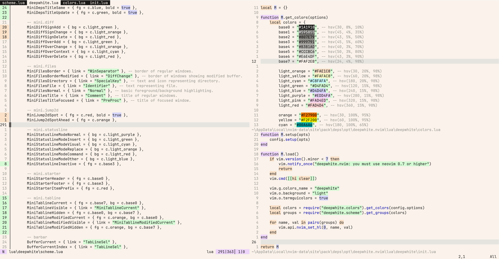

<p align="center">
  <h2 align="center">DeepWhite</h2>
</p>



## About

DeepWhite is a light colorscheme inspired by [flatwhite-syntax](https://github.com/biletskyy/flatwhite-syntax) and [elegant-emacs](https://github.com/rougier/elegant-emacs).

## Requirements

- Neovim 0.7 or newer and a truecolor terminal. Core regression tests were run on **0.7.0 and 0.12.6**;
  intermediate versions have not each been independently tested.
- Modern `@…` highlight group names are applied on Neovim 0.8+. On 0.7 the theme omits these groups
  and links targeting them to avoid invalid-name warnings; it does not provide legacy `TS*` aliases.
  Actual semantic tokens and other newer features still require a Neovim version implementing them.
- Plugins and plugin managers have their own minimum versions. The optional mini.nvim UI tests below
  were verified on 0.12.6, not 0.7.
- A terminal with undercurl support is recommended for diagnostic underlines.

## Installation

With lazy.nvim, configure the theme **before** loading it:

```lua
{
    'Verf/deepwhite.nvim',
    lazy = false,
    priority = 1000,
    opts = {
        low_blue_light = false,
        terminal_colors = false,
    },
    config = function(_, opts)
        require('deepwhite').setup(opts)
        vim.cmd [[colorscheme deepwhite]]
    end,
}
```

With packer.nvim:

```lua
use {
    'Verf/deepwhite.nvim',
    config = function()
        require('deepwhite').setup({ low_blue_light = false })
        vim.cmd [[colorscheme deepwhite]]
    end,
}
```

No `setup()` call is needed if you want the defaults: `:colorscheme deepwhite` is enough.

## Configuration

Defaults (use this directly if you do not configure the theme through your plugin manager):

```lua
require('deepwhite').setup({
    low_blue_light = false,
    terminal_colors = false,
    on_colors = function(colors) end,
    on_highlights = function(groups, colors) end,
})
vim.cmd [[colorscheme deepwhite]]
```

- `low_blue_light`: use a neutral/cooler `#FAFAFA` background instead of the warm `#FAF2EB`.
  This compensates for an **external** warm filter such as f.lux; it does not reduce blue light itself
  or provide a medical eye-care guarantee.
- `terminal_colors`: opt in to setting `vim.g.terminal_color_0` through `vim.g.terminal_color_15`.
  The default is **false**, which leaves all existing values untouched. Disabling it later does not
  restore or clear previously set values. Enable it before opening terminal buffers; existing ones
  may need to be reopened. ANSI white slots deliberately use dark foregrounds for readability on light backgrounds.
  This controls terminals inside Neovim only; external terminal presets are separate static files (see below).
- `on_colors(colors)`: mutate a fresh palette after the background option is applied, before groups
  and terminal colors are generated. Original `base*`, `light_*` and `bright_*` colors remain available.
- `on_highlights(groups, colors)`: mutate or replace group definitions before they are applied.
  Use the same attributes as `nvim_set_hl`. Both hooks mutate their arguments; return values are ignored.

`setup()` incrementally updates the previous options; omitted options, including callbacks, are retained.
Calling `setup()` or `setup({})` alone does not reload the theme. Apply changes with
`:colorscheme deepwhite`. To remove a previous callback, replace it with an empty function.
Boolean options require booleans and hooks require functions; invalid types report an error without updating options.

### Color and highlight overrides

The warm paper and pastel syntax backgrounds are preserved. These foreground roles are designed for
information that must remain readable on either background:

| Palette key | Default | Main use |
| --- | --- | --- |
| `comment` | `#66635D` | Comments, inlay hints, line numbers |
| `warning` | `#A64B00` | Warnings, orange information accents |
| `hint` | `#006E73` | Diagnostic hints, cyan information accents |
| `success` | `#216F21` | OK diagnostics, green information accents |
| `yellow_fg` | `#806000` | Yellow brackets and icons, ANSI yellow |
| `git_add` | `#216F21` | GitSigns and MiniDiff added signs |
| `git_change` | `#A64B00` | GitSigns and MiniDiff changed signs |
| `git_delete` | `#A60000` | GitSigns and MiniDiff deleted signs |

`git_*` roles are initialized before `on_colors` runs. They are independent values, not live aliases:
if a callback changes `warning` and should also affect Git changes, set `git_change` explicitly.
Likewise, change `comment` rather than `base3` to customize the comment foreground.

```lua
require('deepwhite').setup({
    on_colors = function(colors)
        colors.comment = '#595855'
        colors.warning = '#884400'
        colors.git_change = colors.warning
    end,
    on_highlights = function(groups, colors)
        groups.Comment.italic = true
        -- Replace a linked group instead of adding attributes alongside its link.
        groups.DiagnosticWarn = { fg = colors.warning, bold = true }
    end,
})
vim.cmd [[colorscheme deepwhite]]
```

A `link` takes precedence over other attributes, following Neovim's native semantics.
For example, use `groups.Comment = { link = 'Type' }` to link a group, or replace a linked group
with `{ fg = '#123456' }` to give it its own color. Hooks run on each theme load; lualine's theme
module also evaluates `on_colors` when imported. Keep callbacks focused on modifying their arguments.
Callback errors include the hook name and traceback and occur before the active highlights are cleared.

The default informative foregrounds target a contrast ratio of at least 4.5:1; critical Git signs target
at least 3:1. Tests cover both normal backgrounds, the MiniDiff change overlay, and comments on CursorLine.
Decorative whitespace is intentionally subtle. These are design targets, not a blanket accessibility
certification for all plugins, terminal filters or user overrides.

### External terminal presets

The files in `extra/` use the warm `#FAF2EB` background. Kitty, WezTerm, Windows Terminal and Xresources
share all 16 slots with the default `get_terminal_colors()` mapping used by `terminal_colors = true`.
Green, yellow and cyan use the readable `success`, `yellow_fg` and `hint` roles. Nominal ANSI white
slots 7 and 15 deliberately use dark grays (`#595855` / `#1A1918`) so white foreground text does not
vanish on the light background; bright black uses `comment` (`#66635D`).

| File | Use |
| --- | --- |
| `deepwhite_kitty.conf` | Include from your Kitty configuration |
| `deepwhite_wezterm.toml` | Place in a WezTerm color-scheme directory and select `deepwhite` |
| `deepwhite_windows_terminal.json` | Add this scheme object to Windows Terminal's `schemes` array and select it for a profile |
| `deepwhite_xresources.Xresources` | Merge into your existing Xresources configuration |
| `vivid_themes_deepwhite.yml` | Generate `LS_COLORS` with `vivid generate /path/to/vivid_themes_deepwhite.yml` |

The vivid theme uses readable foreground roles for symlinks, executables and device/FIFO entries.
Setuid files retain a red background but use light text. Its existing subtle background tints remain:
not every palette difference is a readability problem. Terminal cursor/tab/border settings and WezTerm's
extended indexed colors 16/17 are also unchanged; the shared mapping covers slots 0–15 only.

These are static warm-background presets: `on_colors` and `low_blue_light` do not rewrite them.
Tests target at least 4.5:1 for all 16 ANSI foregrounds against the configured default background and
for vivid's explicit text styles using these presets. This does not guarantee arbitrary ANSI
foreground/background combinations, reverse-video applications, transparent backgrounds, or terminals'
color transformations. The files are maintained directly, with regression checks rather than a generator.

### Plugin integration policy

Prefer a plugin's native/default highlight links when they already look right. Style the shared Neovim
groups first, and add a plugin-specific override only for an observed visual or semantic mismatch.
A complete inventory of plugin group names is not a goal.

### Completion and LSP floats

mini.completion already uses suitable default links for its active parameter, deprecated candidates,
and outdated-documentation border. DeepWhite leaves these to the module instead of redefining them:

- `MiniCompletionActiveParameter` follows `LspSignatureActiveParameter` (underline by default).
- `MiniCompletionDeprecated` follows `DiagnosticDeprecated` (strikethrough).
- `MiniCompletionInfoBorderOutdated` follows `DiagnosticFloatingWarn` (warning foreground).

Native popup-menu matches use a deep teal foreground and bold text through `PmenuMatch` / `PmenuMatchSel`.
No match background is set, so the selected row keeps its soft gray background. These groups are used
when Neovim highlights matches, for example with fuzzy completion; the theme does not change `completeopt`.
Documentation, signature and hover windows continue to use `NormalFloat` / `FloatBorder`.

Customize the shared native group rather than adding a mini-only equivalent:

```lua
require('deepwhite').setup({
    on_highlights = function(groups, colors)
        groups.LspSignatureActiveParameter = { fg = colors.hint, bold = true, underline = true }
    end,
})
vim.cmd [[colorscheme deepwhite]]
```

### mini.nvim navigation

DeepWhite styles mini.pick and mini.files without loading or configuring them. Set up the modules
in your own configuration as usual; no extra theme option is needed.

| Element | Appearance |
| --- | --- |
| Current picker item / file explorer row | Soft gray background and bold text |
| Marked picker items | Existing pale orange background plus underline |
| Query matches | Deep teal and bold, including on current or marked items |
| Picker preview region | Pale cyan background, dark text, bold and underline |
| Directories | Deep teal and bold; fallback directory icons use the same style |
| Ordinary files | Normal readable foreground |
| Inactive titles / picker border information | Muted but readable foreground |
| Focused file explorer title | Dark and bold |
| File explorer with pending edits | Warning-colored border, distinct from ordinary navigation |

Row highlights leave the foreground unset, preserving query matches and file icon colors.
When an item is both current and marked, bold text and underline distinguish it from other marked items.
Icons supplied by mini.icons keep their own category colors.

This does not replace MiniPick's `source.show`: its default renderer does not expose separate highlight
ranges for the directory prefix and basename of a path. Path segmentation, custom truncation, mappings,
window sizes and file operations remain under your mini.nvim configuration's control.

### mini.diff overlays

MiniDiff's default links now handle changed spans: `MiniDiffOverChange` follows `DiffText`, and
`MiniDiffOverChangeBuf` follows that same style. Changed words use the stronger orange background
with dark text on both the reference and current lines. `DiffText` explicitly sets the dark foreground
so a changed comment does not retain a low-contrast muted foreground over that background.

Current-buffer context is left to the module's empty default, preserving syntax colors and CursorLine.
Reference context keeps a pale orange background; additions and deletions keep soft green and red.
Selections remain visible over changed text, and diagnostic underlines can coexist with the overlay.
Customize `DiffText` through `on_highlights` to affect both native diff text and MiniDiff changed spans.

The dedicated MiniDiff sign links are intentional: this theme's native `Added` / `Changed` / `Removed`
groups style line backgrounds, while signs need readable foregrounds from the shared Git color roles.
The theme does not configure MiniDiff's source, mappings, priority, or overlay toggle.

### CodeDiff

CodeDiff derives line backgrounds from `DiffAdd` / `DiffDelete`, but its default character backgrounds
are darker derivatives that retain syntax foregrounds. With DeepWhite's default comment foreground,
comments on those changed spans fall below the 4.5:1 target; deleted-line context also needs a lighter
background. Merge this into your existing CodeDiff setup for readable comment contexts and word changes:

```lua
require('codediff').setup({
    highlights = {
        line_delete = '#FAE1E1',
        char_insert = 'DiffText',
        char_delete = 'DiffText',
    },
})
```

The lighter red line background preserves readable comments. Changed words on both sides use the
stronger orange `DiffText` background and dark foreground, following native diff/MiniDiff semantics.
The literal deletion color belongs to CodeDiff's configuration and is not changed by `on_colors`.
CodeDiff reapplies these choices after theme reload; customizing `DiffText` also customizes these spans.
Do not try to override `CodeDiffCharInsert` / `CodeDiffCharDelete` only in `on_highlights`: CodeDiff
rebuilds them after the theme loads. DeepWhite does not configure CodeDiff or install an ordering hook.
**The comment-readability fix requires the configuration above; it is not automatic.**

For CodeDiff's optional `diff.gutter_signs`, DeepWhite provides readable foreground-only sign and
line-number links to `GitSignsAdd` / `GitSignsDelete`, instead of deriving foregrounds from pastel
backgrounds. Native status/conflict links are retained. The theme does not enable gutter signs or
change CodeDiff mappings, layout, Git operations or conflict actions.

### Markdown, multicursor and workflow hints

render-markdown keeps its default links for code blocks, links, lists, checkboxes, quotes and tables.
DeepWhite's six existing heading-background overrides keep titles bold without introducing diff colors.
The UI test below covers retained code fences, no language banner, no Setext rendering, visible HTML
comments and disabled LaTeX; it does not certify every render-markdown option.

multicursor keeps its default cursor, selection and match-preview groups. `Visual` now supplies a dark
foreground as well as a gray background so selected comments remain readable in ordinary and additional
selections. Selected syntax foreground colors are intentionally replaced. Enabled/disabled cursors retain
the upstream solid/dotted sign distinction; no extra multicursor color scheme is needed.

which-key's modern preset and mini.cmdline's range-preview window also use their existing/default links.
Their checked text, titles, borders and line numbers need no additional plugin-specific overrides.
Experimental Neovim UI2 message windows are not included in these plugin UI checks.

### Statusline and tabline

```lua
require('lualine').setup({
    options = { theme = 'deepwhite' },
})
require('barbar').setup({
    icons = { filetype = { custom_colors = true } },
})
```

The lualine theme no longer changes `fillchars`. If you want the previous horizontal-line decoration,
opt in yourself:

```lua
vim.opt_global.fillchars:append { stl = '─', stlnc = '─' }
vim.opt_local.fillchars:append { stl = '─', stlnc = '─' }
```

The screenshots illustrate the layout; they predate the readable-foreground adjustments above.

- lualine theme


- barbar theme


## Tests

From the repository root, on Neovim 0.7 or newer:

```sh
nvim --headless -u NONE -i NONE -n -c 'luafile tests/run.lua' -c 'cquit 1'
```

No test framework or plugin installation is needed. The runner checks theme loading without warnings,
resolved highlights, configuration and hook behavior, lualine option isolation, all four external ANSI
palettes, vivid foreground roles, and contrast ratios. Extra-file readers cover the checked-in layouts;
they are not general TOML/YAML parsers or terminal-application integration tests.
It uses the appropriate highlight-reading API for the running version;
assertions for applied `@…` groups run only where those names are supported. All existing modern-version
assertions remain enabled. A failure exits with a nonzero status; the final `cquit 1` also guards against
uncaught Lua errors that prevent the runner from exiting normally. To run an affected test in isolation:

```sh
DEEPWHITE_TEST='lualine preserves' nvim --headless -u NONE -i NONE -n -c 'luafile tests/run.lua' -c 'cquit 1'
```

[The CI workflow](.github/workflows/tests.yml) runs this core suite on Linux with Neovim **0.7.0** and the
**latest official stable release** for pushes, pull requests, and manual runs. The stable job follows
new releases; the locally verified stable version for this change is 0.12.6. Plugin UI tests remain
separate, optional checks rather than part of the minimum-version compatibility promise.

An optional integration test uses **real mini.pick and mini.files modules** in an embedded Neovim
with an attached UI. Point it at your mini.nvim runtime directory (no automatic downloads):

```sh
DEEPWHITE_MINI=/path/to/mini.nvim nvim --headless -u NONE -i NONE -n -l tests/mini.lua
```

It checks composed screen styles for current/marked/matching items, a preview region, directory columns
and a pending-edit border on both backgrounds, plus module/theme load order. It creates temporary
fixtures, never synchronizes file operations, and does not read your Neovim configuration.
Validated with Neovim 0.12.6 and mini.nvim commit
[`a321b535c75c`](https://github.com/nvim-mini/mini.nvim/tree/a321b535c75ca88ba7fddfd8eb5b583fbda50dd6).
A separate optional test uses real mini.completion and the Neovim LSP client with an **in-memory LSP
response fixture**, so no external language server is required:

```sh
DEEPWHITE_MINI=/path/to/mini.nvim nvim --headless -u NONE -i NONE -n -l tests/completion.lua
```

It checks default-link inheritance, native popup matches and selection, deprecated candidates,
outdated/resolved documentation, signature parameter customization after reload, and native hover
on both backgrounds. It was validated with the same Neovim and mini.nvim versions above. This tests
the UI/LSP rendering paths, not the correctness of arbitrary external language servers.

A third optional test uses real mini.diff with its manual-reference (`none`) source:

```sh
DEEPWHITE_MINI=/path/to/mini.nvim nvim --headless -u NONE -i NONE -n -l tests/diff.lua
```

It checks word-diff context and changed spans (including a comment foreground), additions, multiline
deletions, unequal replacements, empty lines, sign colors, CursorLine/selection/diagnostic composition,
and native-group customization after reload on both backgrounds. All text is in memory: no Git staging,
filesystem fixtures, or user configuration are involved. It was validated with the versions above.
The test uses experimental `nvim__inspect_cell()` on the default UI grid to compare rendered colors and
styles, rather than internal attribute IDs; its helper may need adjustment for future Neovim versions.
It does not exercise MiniDiff's Git source or certify other Neovim versions.

Three more optional attached-UI checks cover the additional workflow plugins:

```sh
DEEPWHITE_CODEDIFF=/path/to/codediff.nvim nvim --headless -u NONE -i NONE -n -l tests/codediff.lua

DEEPWHITE_MARKDOWN=/path/to/render-markdown.nvim \
DEEPWHITE_TREESITTER=/path/to/nvim-treesitter/runtime \
nvim --headless -u NONE -i NONE -n -l tests/markdown.lua

DEEPWHITE_MULTICURSOR=/path/to/multicursor.nvim \
DEEPWHITE_WHICHKEY=/path/to/which-key.nvim \
DEEPWHITE_MINI=/path/to/mini.nvim \
nvim --headless -u NONE -i NONE -n -l tests/workflow.lua
```

- **CodeDiff:** actual native diff computation and rendering into in-memory buffers, default plain-text
  line/word differences, the documented comment-readability recipe, optional gutter signs/numbers, and
  customization after theme reload. Its native diff library must already be installed; auto-installation
  is disabled. This does not exercise Git sources, full explorer/history views or conflict actions.
- **Markdown:** real rendering and Treesitter highlighting for headings, links, code, lists, checkboxes,
  quotes and tables, plus insert/normal-mode transitions. Requires installed `markdown`, `markdown_inline`
  and `lua` parsers. `DEEPWHITE_TREESITTER` optionally supplies queries; `DEEPWHITE_PARSERS` can point to
  another runtime with `parser/*.so`. No parsers are downloaded by the test.
- **Workflow:** actual enabled/disabled multicursors, match preview, selections over comments, which-key
  modern menus and mini.cmdline range previews. Omitting `DEEPWHITE_MINI` skips mini.cmdline/icon checks.

All three cover both backgrounds and accept `DEEPWHITE_TEST` as a test-name substring filter. They use
screen attributes or experimental cell inspection to check composed styles, not just group existence;
the helpers may need adjustment for future Neovim versions. They do not read your personal configuration.

Latest local verification used Neovim **0.12.6**, with **56 core checks and 66 optional UI checks passing**.
Plugin revisions for this verification (including the three earlier mini.nvim suites):

| Plugin | Revision |
| --- | --- |
| mini.nvim | `f9ac12d7cbd2563cfc2cce9a8152fc8df2ad0d6f` |
| codediff.nvim | `09d9ebef2cc5a5c04db7a349cd6c61bdf84ecc8e` |
| render-markdown.nvim | `9c235bedc4f96145e63fcad5b78cd78bce8822c4` |
| nvim-treesitter queries | `19bdfc04f40ed2ccb3340591d125f759b0406875` |
| multicursor.nvim | `c574bfc1f7e63dfea3e64b8453c9f7c660127238` |
| which-key.nvim | `3aab2147e74890957785941f0c1ad87d0a44c15a` |

These checks do not certify the rendering of your terminal's fonts or Nerd Font icons; the navigation
UI test uses ASCII file prefixes to avoid requiring a particular font.

See [the audit and optimization plan](docs/AUDIT.md) for the original findings and remaining work.

## Q & A

#### Which statusline and tabline are you using?

Now: [mini.statusline](https://github.com/echasnovski/mini.nvim/blob/main/readmes/mini-statusline.md) and [mini.tabline](https://github.com/echasnovski/mini.nvim/blob/main/readmes/mini-tabline.md)

Previous:

<details>
<summary>customizd heirline</summary>
    
```lua
{
    'rebelot/heirline.nvim',
    opts = function(_, opts)
        vim.opt.fillchars:append { eob = ' ', stl = '─', stlnc = '─' }
        local conditions = require 'heirline.conditions'
        local utils = require 'heirline.utils'
        local Align = { provider = '%=', hl = 'Normal' }
        local Space = { provider = '───', hl = 'Normal' }
        local Git = {
            condition = conditions.is_git_repo,
            init = function(self)
                self.status_dict = vim.b.gitsigns_status_dict
                self.has_changes = self.status_dict.added ~= 0
                    or self.status_dict.removed ~= 0
                    or self.status_dict.changed ~= 0
            end,
            hl = 'Normal',
            Space,
            { -- git branch name
                provider = function(self)
                    return '  ' .. self.status_dict.head
                end,
                hl = { bold = true },
            },
            {
                provider = function(self)
                    local count = self.status_dict.added or 0
                    return count > 0 and (' +' .. count)
                end,
            },
            {
                provider = function(self)
                    local count = self.status_dict.removed or 0
                    return count > 0 and (' -' .. count)
                end,
            },
            {
                provider = function(self)
                    local count = self.status_dict.changed or 0
                    return count > 0 and (' ~' .. count)
                end,
            },
            {
                condition = function(self)
                    return self.has_changes
                end,
                provider = ' ',
            },
        }
        local FileFormat = {
            provider = function()
                local enc = (vim.bo.fenc ~= '' and vim.bo.fenc) or vim.o.enc
                local fmt = vim.bo.fileformat
                return ' ' .. enc .. '[' .. fmt .. '] '
            end,
            hl = 'Normal',
        }
        local Ruler = {
            provider = ' %l/%L | %c/%-2{virtcol("$") - 1} ',
            hl = 'Normal',
        }
        -- statusline
        local DefaultStatusline = {
            Git,
            Align,
            FileFormat,
            Ruler,
            Space,
        }
        local InactiveStatusline = {
            condition = conditions.is_not_active,
            Align,
        }
        local SpecialStatusline = {
            condition = function()
                return conditions.buffer_matches {
                    buftype = { 'nofile', 'prompt', 'help', 'quickfix' },
                    filetype = { '^git.*', 'fugitive' },
                }
            end,
            Align,
        }
        opts.statusline = {
            fallthrough = false,
            SpecialStatusline,
            InactiveStatusline,
            DefaultStatusline,
        }
        -- tabline
        local TablineFileName = {
            provider = function(self)
                local filename = self.filename
                filename = filename == '' and '[No Name]' or vim.fn.fnamemodify(filename, ':t')
                return filename
            end,
        }
        local TablineFileNameBlock = {
            init = function(self)
                self.filename = vim.api.nvim_buf_get_name(self.bufnr)
            end,
            hl = function(self)
                if self.is_active then
                    return 'TabLineSel'
                else
                    return 'TabLine'
                end
            end,
            { provider = ' ' },
            TablineFileName,
            { provider = ' ' },
        }
        local BufferLine = utils.make_buflist(TablineFileNameBlock)
        local Tabpage = {
            provider = function(self)
                return '%' .. self.tabnr .. 'T ' .. self.tabpage .. ' %T'
            end,
            hl = function(self)
                if not self.is_active then
                    return 'TabLineSel'
                else
                    return 'TabLine'
                end
            end,
        }
        local TabPages = {
            condition = function()
                return #vim.api.nvim_list_tabpages() >= 2
            end,
            utils.make_tablist(Tabpage),
        }
        opts.tabline = { BufferLine, Align, TabPages }
    end,
}
</details>
